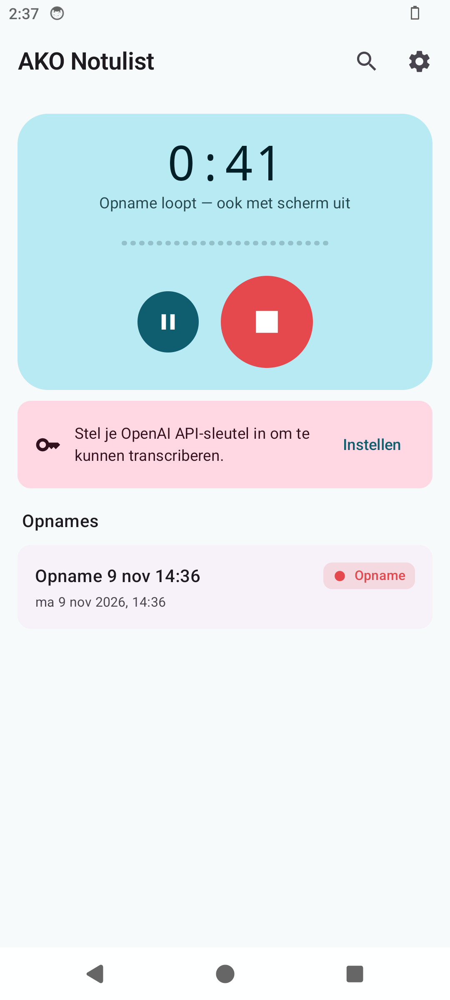
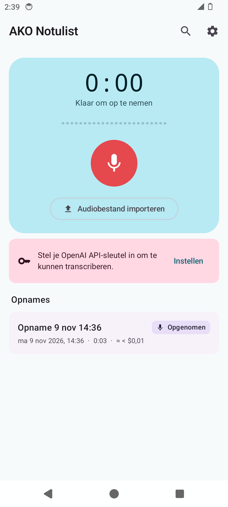
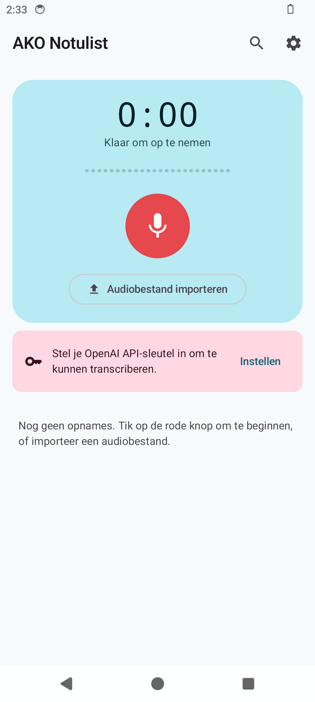
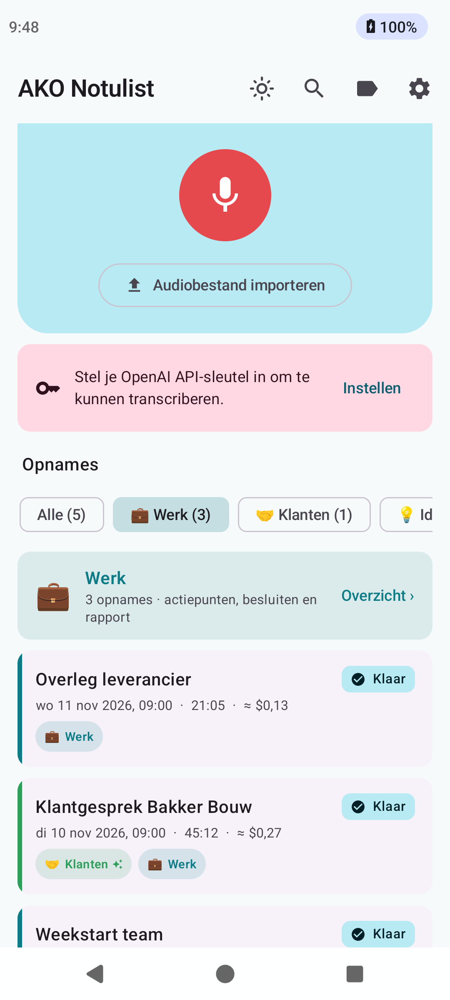
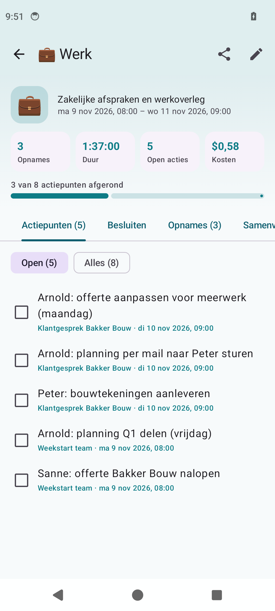
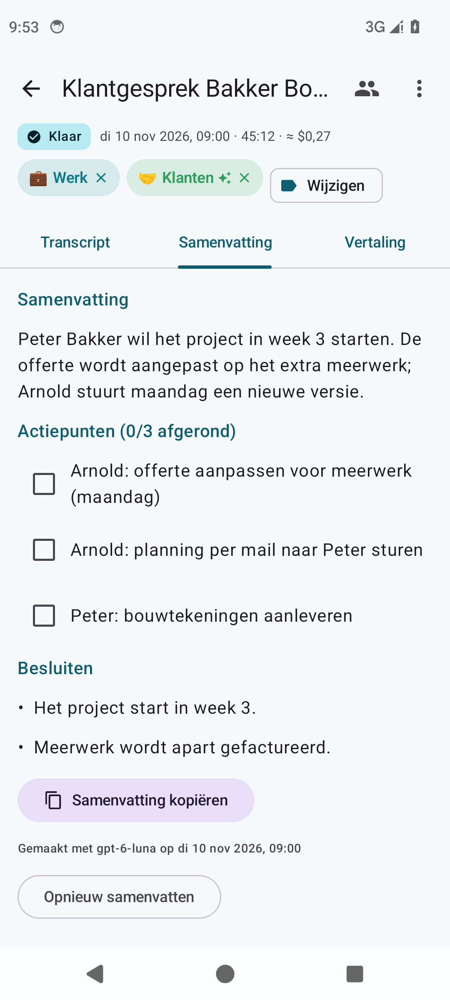
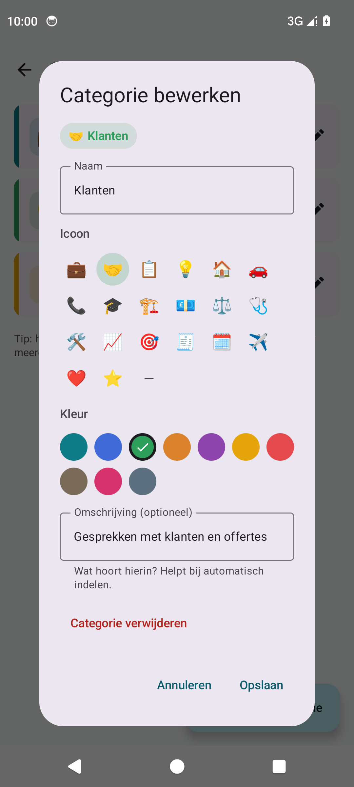

# AKO Notulist

Android-app die spraak opneemt en via de OpenAI API omzet naar Nederlandse tekst, met
sprekerherkenning, tijdstempels, een optionele samenvatting (actiepunten en besluiten) en
eenvoudige bediening in **Android Auto**. De app wordt niet via de Play Store verspreid: je
installeert de APK zelf (sideloaden).

- **Package / applicationId:** `nl.arnoldkolkman.akonotulist`. Dit staat vast en mag nooit
  veranderen, anders kun je niet meer bijwerken.
- **Minimaal Android 8.0** (API 26), gebouwd tegen Android 17 (API 37).
- **Geen analytics, geen trackers.** Audio gaat alleen naar `api.openai.com`.

<p>
  
  
  
</p>

_Schermafbeeldingen van een echte rooktest op een Android 14-emulator._

---

## Inhoud

1. [Functies](#functies)
2. [Modellen en kosten](#modellen-en-kosten)
3. [Bouwen](#bouwen)
4. [Release-keystore: maken en bewaren](#release-keystore-maken-en-bewaren)
5. [Versiebeheer en releases](#versiebeheer-en-releases)
6. [Installeren met een pc](#installeren-met-een-pc)
7. [Installeren zonder pc](#installeren-zonder-pc)
8. [Android Auto instellen](#android-auto-instellen)
9. [Testen met de Desktop Head Unit (DHU)](#testen-met-de-desktop-head-unit-dhu)
10. [Gebruik](#gebruik)
11. [Architectuur](#architectuur)
12. [Problemen oplossen](#problemen-oplossen)

---

## Functies

**Opnemen**
- Opnemen via een foreground service (`foregroundServiceType="microphone"`, geschikt voor
  Android 14+). De opname loopt door met het scherm uit.
- Een vaste melding met **Pauze/Hervatten** en **Stop**.
- Formaat: AAC in `.m4a`, mono, 16 kHz, 32 kbps. Dat is ongeveer 14 MB per uur.
- Importeren van m4a, mp3, wav, ogg/opus en meer, via **Delen met…** of de knop
  *Audiobestand importeren*. Elk bestand wordt omgezet naar hetzelfde spraakformaat.

**Handig tijdens het opnemen**
- **Scherm aanhouden:** de ☀-knop rechtsboven houdt het scherm aan zolang de app open is.
  Handig als de telefoon op tafel ligt.
- **Markeringen:** tik tijdens een opname op ⭐, in de app, in de melding of in de auto, om
  een belangrijk moment vast te leggen.
  - In het detailscherm staan de markeringen als chips: tik erop om naar dat moment te
    springen, of op ✕ om ze te verwijderen.
  - De zin die op dat moment werd uitgesproken krijgt een ⭐ in het transcript.
  - De markeringen gaan mee in de export.
  - De samenvatting geeft deze momenten extra aandacht.
- **Snelle-instellingentegel "Opname":** voeg hem toe via het potloodje in het meldingenpaneel.
  Daarmee start of stop je een opname met één tik.
- **App-snelkoppeling:** houd het app-icoon ingedrukt en kies **Opname starten**.
- **Samenvatting kopiëren:** gebruik de knop op het tabblad Samenvatting, of houd de tekst
  ingedrukt om een deel te selecteren.

**Transcriptie**
- Standaard met **sprekerherkenning** (`gpt-4o-transcribe-diarize`). Andere modellen kies je in
  de instellingen.
- **Altijd Nederlands:** de gpt-4o-modellen geven Nederlandse spraak soms terug als Engelse
  vertaling, voor een heel deel of halverwege een deel. De app controleert dat per zin.
  - Engelse stukken worden **opnieuw beluisterd** met Whisper, dat geforceerd Nederlands
    uitschrijft. Je krijgt dus de woorden die echt gezegd zijn, geen terugvertaling.
  - Alleen de Engelse stukken worden vervangen; de sprekers worden op tijd overgenomen.
  - Lukt opnieuw beluisteren niet, dan vertaalt het chatmodel de zinnen als noodoplossing.
  - Een bestaand (deels) Engels transcript herstel je met **Omzetten naar NL** in het
    detailscherm. Dat werkt het best zolang de audio nog op het toestel staat.
- De taal staat standaard op `nl`. Een eigen **woordenlijst** met namen en vaktermen verbetert
  de herkenning.
- Lange opnames worden automatisch geknipt in stukken van 10 minuten met 10 seconden overlap.
  De stukken worden zonder hercodering geknipt en apart verstuurd.
- Bij het samenvoegen worden de stukken **woord voor woord aan elkaar gestikt**, zonder
  dubbele of verloren zinnen, en krijgen ze de juiste absolute tijdstempels.
- **Sprekers blijven consistent over stukken heen.** Na het eerste stuk knipt de app per spreker
  een kort referentiefragment en stuurt dat mee als `known_speaker_references[]`.
- Uploaden gebeurt via **WorkManager**: alleen met netwerk, met exponentiële backoff en
  zichtbare voortgang (in de app en als melding).
- **3 delen tegelijk**, met echte voortgang ("4 van 14 delen klaar · uploaden 63% · OpenAI verwerkt
  2 delen (1:12)"). Een opname van 2 uur is daardoor ongeveer 3× sneller klaar.
- Mag de taak niet als voorgrondtaak draaien, dan werkt de app in korte rondes en gaat hij steeds
  verder bij het volgende deel. Er wordt nooit een deel halverwege weggegooid of dubbel betaald.
- Een **verwerkingslog** per opname (menu ⋮) laat precies zien wat er gebeurt: verstuurd, wachten
  op OpenAI, klaar, of waarom het wacht.
- Afgeronde stukken worden opgeslagen. Een nieuwe poging betaalt dus nooit twee keer voor
  dezelfde audio.

**Nabewerking (optioneel)**
- Een **samenvatting, actiepunten en besluiten** in het Nederlands, via een chatmodel met een
  strikt JSON-schema (Structured Outputs).
- Een algemene titel als "Opname 9 nov 14:03" wordt vervangen door een inhoudelijke titel.
- **Sprekers hernoemen** ("Spreker A" → "Jan"). Twee sprekers dezelfde naam geven voegt ze
  samen. Je kunt ook één zin aan een andere spreker toewijzen.
- Kies je een model zonder sprekerherkenning, dan kan het chatmodel per zin inschatten wie er
  spreekt. Alleen de labels worden aangepast, de tekst blijft ongewijzigd.

**Categorieën**
- Maak categorieën aan met een naam, emoji, kleur en korte omschrijving: tik op 🏷 in de
  bovenbalk. Er zijn suggesties om snel te beginnen (Werk, Klanten, Overleg, Ideeën, Privé).
- Een **filterbalk** boven de lijst: *Alle · 💼 Werk (12) · 🤝 Klanten (5) · Zonder categorie*.
  Elke opname krijgt gekleurde labels en een gekleurd streepje.
- **Overzicht per categorie**:
  - cijfers: aantal opnames, totale duur, open acties en kosten;
  - een **gezamenlijke afvinklijst met alle actiepunten** uit alle opnames, met voortgangsbalk;
  - tabbladen met besluiten, opnames en samenvattingen;
  - het geheel **delen als rapport** (.docx, .md of .txt).
- **Automatisch indelen:** na het transcriberen kiest het chatmodel de passende categorie
  (gemarkeerd met ✨). In het detailscherm kan dit ook met de knop **✨ Voorstellen**.
  Handmatige keuzes worden nooit overschreven, en de functie is uit te zetten in Instellingen.
- **Meerdere opnames tegelijk indelen:** houd een opname ingedrukt, tik op de andere en kies 🏷.
- Actiepunten zijn ook in het detailscherm af te vinken, gekoppeld aan het overzicht van de categorie.

<p>
  
  
  
  
</p>

**Vertalen**
- Op het tabblad **Vertaling** vertaal je met één tik het transcript en de samenvatting naar
  het **Engels**, **Duits** of **Frans**.
- De vertaling loopt op de achtergrond door, ook als je het scherm verlaat, en wordt bewaard.
- Je kunt de vertaling kopiëren of delen.
- Tik op een vertaalde zin om de audio naar dat moment te laten springen.

**Sprekers benoemen (ook achteraf)**
- Er verschijnt een melding **"Wie is wie?"** in het transcript, of gebruik het 👥-icoon bovenin.
- **Namen voorstellen uit gesprek:** het chatmodel leidt namen af uit aanspreekvormen en
  voorstelrondjes, zoals "Goedemorgen Jan". Jij controleert en bevestigt.
- Na het hernoemen biedt de app aan om de samenvatting bij te werken met de nieuwe namen.

**Overzicht en export**
- Een lijst met datum, duur, status (met voortgang) en kostenschatting.
- Een detailscherm met het transcript per spreker, met tijdstempels en kleuren.
- **Tik op een zin om de audio naar dat moment te laten springen.** De zin die speelt is
  gemarkeerd en de lijst scrollt mee.
- Afspeelsnelheid 1× tot 2×.
- Delen als **.txt**, **.md** of **.docx** (een echt Word-document met koppen), of kopiëren
  naar het klembord.
- **Zoeken** in alle transcripten via een volledige-tekstindex (SQLite FTS4).

**Instellingen**
- **OpenAI API-sleutel**, versleuteld met een AES-256-GCM-sleutel in de **Android Keystore**.
  De sleutel wordt nooit gelogd en nooit meegenomen in een back-up.
- Model, taal, woordenlijst, samenvatting aan/uit, chatmodel, automatisch transcriberen na
  stoppen, bewaartermijn van audio (de tekst blijft) en het tarief per model voor de
  kostenschatting.

**Android Auto** (Car App Library, categorie IOT)
- Een rijveilig scherm met grote knoppen **Start opname** en **Stop** (en Pauze/Hervatten).
- Status in de auto: opname met timer, transcriberen met percentage, of klaar.
- Een lijst met **recente opnames** en hun status.
- Samenvatting en transcript **alleen bij stilstand**, via de `LongMessageTemplate` die de
  auto alleen toont als je geparkeerd staat.
- Een gesproken melding **"Transcriptie klaar"**; die kun je uitzetten.

---

## Modellen en kosten

Gecontroleerd tegen de officiële OpenAI-documentatie (november 2026):

| Model | Sprekers | Tijdstempels | Prijs per audiominuut* | Opmerking |
|---|---|---|---|---|
| `gpt-4o-transcribe-diarize` (standaard) | ja | ja | $0,006 | **Stopt op 26-02-2027** |
| `gpt-transcribe` | geschat** | geschat | $0,0045 | Nieuw aanbevolen model |
| `gpt-4o-transcribe` | geschat** | geschat | $0,006 | Stopt op 26-02-2027 |
| `gpt-4o-mini-transcribe` | geschat** | geschat | $0,003 | Stopt op 26-02-2027 |
| `whisper-1` | geschat** | ja | $0,006 | Stopt op 26-02-2027 |

\* Standaardtarieven. Je kunt ze per model aanpassen onder *Instellingen → Kosten*.
\*\* Alleen als *Sprekers schatten* aan staat.

> **Let op:** OpenAI stopt op **26 februari 2027** met alle gpt-4o-transcriptiemodellen,
> inclusief het diarisatiemodel. Weigert de API het gekozen model, dan schakelt de app
> automatisch over op `gpt-transcribe` en schat het chatmodel de sprekers. Er is geen update
> nodig.

De samenvatting gebruikt standaard `gpt-6-luna` ($0,10 / $0,50 per miljoen tokens). Een
vergadering van een uur kost daarmee ruim onder een cent extra.

---

## Bouwen

**Wat je nodig hebt:**
- JDK 17 of nieuwer (21 aanbevolen).
- Android SDK met *Platform 37* en *Build-Tools 37*. Android Studio installeert die
  automatisch.
- `local.properties` met `sdk.dir=…`. Android Studio maakt dit bestand aan; het staat in
  `.gitignore`.

```bash
./gradlew testDebugUnitTest
```

```bash
./gradlew assembleDebug
```

```bash
./gradlew assembleRelease
```

- `testDebugUnitTest` draait de unit tests: opknippen, samenvoegen, tijdstempels, API,
  export en prompts.
- `assembleDebug` bouwt een debug-APK als `nl.arnoldkolkman.akonotulist.debug`. Die kan naast
  de release-versie staan.
- `assembleRelease` bouwt de ondertekende release-APK in `app/build/outputs/apk/release/`.

Op Windows gebruik je `gradlew.bat` in plaats van `./gradlew`.

Zonder `keystore.properties` levert `assembleRelease` een **niet-ondertekende** APK op. Die
kun je niet installeren; zie het volgende hoofdstuk.

### Via GitHub Actions

- **CI** (`.github/workflows/ci.yml`): bij elke push een controle op geheimen, de unit tests,
  lint en een debug-build.
- **Release** (`.github/workflows/release.yml`): bij een tag `v*` (bijvoorbeeld `v1.0.0`)
  bouwt deze workflow de ondertekende APK, controleert de handtekening en publiceert
  `AKO-Notulist-<versie>.apk` met een SHA-256-bestand als **GitHub Release**.

Zet hiervoor eenmalig deze **Secrets** onder *Settings → Secrets and variables → Actions*:

| Secret | Waarde |
|---|---|
| `KEYSTORE_BASE64` | `base64 -w0 ako-notulist-release.jks` (macOS: `base64 -i …`) |
| `KEYSTORE_PASSWORD` | wachtwoord van de keystore |
| `KEY_ALIAS` | `ako-notulist` (of je eigen alias) |
| `KEY_PASSWORD` | wachtwoord van de sleutel |

---

## Release-keystore: maken en bewaren

Elke update moet met **dezelfde sleutel** ondertekend zijn als de eerste installatie.

> ### ⚠️ Maak een aparte back-up van de keystore en het wachtwoord
> Bewaar beide bijvoorbeeld in een wachtwoordkluis en op een offline usb-stick.
> **Raak je de keystore kwijt, dan kun je de app nooit meer bijwerken.** Je moet hem dan
> verwijderen, inclusief alle opnames, en opnieuw installeren.
> De keystore hoort **nooit** in git: `*.jks`, `*.keystore` en `keystore.properties` staan in
> `.gitignore`.

**Makkelijkste manier** (Linux/macOS/Git Bash):

```bash
scripts/new-keystore.sh
```

Dit script maakt `~/.android-keystores/ako-notulist-release.jks` en `keystore.properties`, en
toont de waarden voor de GitHub Secrets.

**Handmatig:**

```bash
keytool -genkeypair -v -keystore ako-notulist-release.jks -alias ako-notulist -keyalg RSA -keysize 4096 -validity 36500
```

Maak daarna `keystore.properties` in de hoofdmap van het project:

```properties
storeFile=/pad/naar/ako-notulist-release.jks
storePassword=…
keyAlias=ako-notulist
keyPassword=…
```

---

## Versiebeheer en releases

De versie staat in `version.properties`:
- `versionCode`: een geheel getal dat **bij elke release omhoog moet**.
- `versionName`: semantic versioning, `MAJOR.MINOR.PATCH`.

Voor een nieuwe release doe je dit in twee stappen. Eerst verhoog je `versionCode`, zet je de
`versionName`, en maak je de commit en de tag `v1.0.0`:

```bash
scripts/bump-version.sh 1.0.0
```

Daarna push je de commit en de tag; de Release-workflow bouwt en publiceert dan de APK:

```bash
git push && git push origin v1.0.0
```

De workflow stopt als de tag niet overeenkomt met `versionName`.

Voor elke commit controleert `scripts/check-secrets.sh` of er geen geheimen meegaan, zoals
OpenAI-sleutels, private keys of hard-gecodeerde wachtwoorden. Installeer de controle als
git-hook:

```bash
ln -s ../../scripts/check-secrets.sh .git/hooks/pre-commit
```

---

## Installeren met een pc

Android Auto toont alleen apps waarvan de **Play Store als installer** geregistreerd staat. De
installatiescripts regelen dat met `adb install -r -i com.android.vending <apk>`.

1. Installeer de [Android SDK Platform-Tools](https://developer.android.com/tools/releases/platform-tools)
   en zorg dat `adb` in je PATH staat.
2. Zet op je telefoon de **Ontwikkelaarsopties** aan: *Instellingen → Over de telefoon* en
   tik 7× op *Buildnummer*.
3. Zet **USB-foutopsporing** aan, of **Draadloze foutopsporing** (`adb pair` en daarna
   `adb connect`).
4. Sluit de telefoon aan en bevestig de vingerafdruk van de pc.
5. Installeer de app.

**Windows (PowerShell):**

```powershell
.\install.ps1 -Apk C:\pad\naar\AKO-Notulist-1.0.0.apk
```

Zonder `-Apk` pakt het script de nieuwste APK uit `app\build\outputs\apk\release\`. Weigert
PowerShell het script, sta het dan voor deze sessie toe:

```powershell
Set-ExecutionPolicy -Scope Process Bypass
```

**Linux/macOS:**

```bash
./install.sh pad/naar/AKO-Notulist-1.0.0.apk
```

De scripts controleren daarna met `pm list packages -i` of `installer=com.android.vending`
is gezet, en stoppen met een waarschuwing als dat niet zo is. Op een toestel **zonder** Play
Store, zoals een standaard emulator, negeert Android de optie `-i` stil.

---

## Installeren zonder pc

1. Download `AKO-Notulist-<versie>.apk` op je telefoon uit de **GitHub Release** van deze
   (privé) repository. Log daarvoor in op github.com in de browser of de GitHub-app.
2. Open de APK en sta **Installeren uit onbekende bronnen** toe voor je browser of
   bestandsbeheer.
3. De app werkt nu op je telefoon. **Android Auto toont hem nog niet**, omdat de installer niet
   de Play Store is. Dat los je op een van deze twee manieren op, allebei via **Draadloze
   foutopsporing** op de telefoon zelf. Daar is geen pc voor nodig.
   - **UnknownAuto:** installeer UnknownAuto, koppel het via *Ontwikkelaarsopties → Draadloze
     foutopsporing → Apparaat koppelen met koppelingscode*, kies **AKO Notulist** en laat de
     app opnieuw installeren met de Play Store als installer.
   - **Een installer op basis van Shizuku**, bijvoorbeeld *Install With Options* of een
     vergelijkbare app:
     1. Installeer **Shizuku** en start het via *Draadloze foutopsporing* (volg de stappen in
        Shizuku).
     2. Open de installer, geef hem Shizuku-toegang en kies de APK.
     3. Zet de *installer package name* op `com.android.vending` en installeer.
4. Controleer in Android Auto (*Launcher aanpassen*) of **AKO Notulist** nu in de lijst staat.

Bij een **update** herhaal je stap 1 tot en met 3. Je gegevens blijven bewaard, zolang de APK
met dezelfde keystore is ondertekend.

---

## Android Auto instellen

1. Open op de telefoon **Android Auto**. Op de meeste telefoons zit dat onder *Instellingen →
   Verbonden apparaten → Verbindingsvoorkeuren → Android Auto*.
2. Scrol naar beneden en tik **10× op "Versie"** (ook wel *Versie en toestemmingsinformatie*).
   Bevestig de vraag om de **ontwikkelaarsinstellingen** aan te zetten.
3. Kies rechtsboven in het menu (⋮) **Ontwikkelaarsinstellingen** en zet **Onbekende bronnen**
   (*Unknown sources*) aan.
4. Ga terug naar de Android Auto-instellingen, open **Launcher aanpassen** (*Customize
   launcher*) en **vink AKO Notulist aan**.
5. Open de app **één keer op de telefoon** en geef toestemming voor de microfoon en meldingen.
   Dan kan de auto direct een opname starten.

> **Let op:** een **update van Android Auto** zet de ontwikkelaarsinstellingen soms terug, zoals
> *Onbekende bronnen*. Verdwijnt AKO Notulist uit de auto, controleer dan stap 2 tot en met 4
> opnieuw. Soms helpt het ook om de app opnieuw te installeren met de Play Store als installer.

---

## Testen met de Desktop Head Unit (DHU)

Met de DHU test je de autoschermen op je pc, zonder auto.

1. Installeer de DHU via Android Studio (*SDK Manager → SDK Tools → Android Auto Desktop Head
   Unit Emulator*) of via de opdrachtregel:

   ```bash
   sdkmanager "extras;google;auto"
   ```

2. Zet op de telefoon de Android Auto-ontwikkelaarsinstellingen aan (zie hierboven). Kies dan
   in het menu ⋮ **Server voor hoofdeenheid starten** (*Start head unit server*).
3. Sluit de telefoon met USB aan en stuur de poort door:

   ```bash
   adb forward tcp:5277 tcp:5277
   ```

4. Start de DHU. Dit is het pad voor Linux/macOS:

   ```bash
   $ANDROID_HOME/extras/google/auto/desktop-head-unit
   ```

   Op Windows start je `%ANDROID_HOME%\extras\google\auto\desktop-head-unit.exe`.

5. Kies in de DHU de app-launcher en open **AKO Notulist**.

Wat je kunt testen:
- **Start opname:** de telefoon toont de opnamemelding en de DHU de lopende timer.
- **Stop:** de status verandert naar *Opgenomen*, en daarna (bij automatisch transcriberen) naar
  *In de wachtrij* en *Transcriberen… x%*.
- **Recente opnames:** tik op een opname met status *Klaar* om de samenvatting of het
  transcript te zien. Simuleer **parkeren en rijden** met de DHU-opdracht `restrict drive` en
  terug naar parkeren met `restrict none`. Tijdens het rijden blokkeert de host de
  `LongMessageTemplate`.
- **"Transcriptie klaar":** hoorbaar via de pc-luidsprekers als de DHU audio doorstuurt.

Handige DHU-opties: `--usb`, voor een directe AOA-verbinding zonder `adb forward`, en
`-c config/default_720p.ini`.

---

## Gebruik

**Op de telefoon:** tik op de rode knop om op te nemen. De opname loopt ook met het scherm uit,
en je kunt pauzeren en stoppen vanuit de melding. Na het stoppen start het transcriberen
automatisch als dat aan staat. In het detailscherm kun je:
- afspelen, en op een zin tikken om naar dat moment te springen;
- sprekers hernoemen via het 👥-icoon;
- de samenvatting bekijken in het tabblad;
- delen of exporteren via het menu ⋮.

**In de auto:** open AKO Notulist en gebruik **Start opname** en **Stop**. Na afloop meldt de
auto "Transcriptie klaar". Lezen kan alleen als je geparkeerd staat.

---

## Architectuur

```
app/src/main/java/nl/arnoldkolkman/akonotulist/
├─ AkoApp.kt          Application + eenvoudige DI-container (AppContainer)
├─ core/              Keystore-opslag API-sleutel, DataStore-instellingen, meldingen, bewaarbeleid
├─ data/              Room: recordings, chunks, segments (+FTS4), speakers, summaries
├─ recording/         Microfoon-foregroundservice, gedeelde opnamestatus, import + transcodering
├─ audio/             Knippen zonder hercodering (MediaExtractor/MediaMuxer), Media3 Transformer
├─ transcribe/        OpenAI-client, modellen, ChunkPlanner, TranscriptMerger, TranscriptionWorker
├─ summary/           Samenvatting en sprekerschatting (Structured Outputs), PostProcessWorker
├─ export/            .txt / .md / .docx en delen
├─ ui/                Jetpack Compose (Material 3): lijst, detail, zoeken, instellingen
└─ car/               Android Auto: CarAppService, Session, schermen (Pane/List/LongMessage)
```

De gegevensstroom: opname of import → `RECORDED` → `TranscriptionWorker` (stukken plannen →
knippen → uploaden → elk stuk opslaan) → `TranscriptMerger` → `PostProcessWorker` (sprekers,
samenvatting) → `DONE` → melding en het event "Transcriptie klaar" voor de auto.

---

## Problemen oplossen

| Probleem | Oplossing |
|---|---|
| App verschijnt niet in Android Auto | Installer moet de Play Store zijn (zie installatie). Controleer *Onbekende bronnen* en *Launcher aanpassen*. Na een Android Auto-update opnieuw controleren. |
| "Starten mislukt" in de auto | Open de app één keer op de telefoon en geef de microfoontoestemming. Android 14+ laat een microfoondienst niet starten zonder eerdere toestemming. |
| Transcriptie blijft "In de wachtrij" | Android start de taak pas bij een netwerk dat het als "met internet" heeft gecontroleerd. Een VPN, een privé-DNS die niet werkt of een netwerk zonder internet (bijv. wifi van de auto) kan dat blokkeren. Bekijk het **Verwerkingslog** (menu ⋮ in de opname). |
| Lange opname gaat traag of in rondes | Android staat de app op de achtergrond geen voorgrondtaak toe zolang de **batterijbeperking** aan staat. De app werkt dan in rondes van 5 min en gaat steeds verder waar hij was. Hef de beperking op via *Instellingen → Achtergrondverwerking*; op Samsung ook *Batterij → Limieten achtergrondgebruik → Nooit in slaapstand*. |
| "Ongeldige OpenAI API-sleutel (401)" | Zet een nieuwe sleutel onder *Instellingen* en tik op **Test**. |
| "OpenAI-tegoed is op" | Controleer je tegoed en limieten op platform.openai.com. Tik daarna op **Opnieuw proberen**; afgeronde delen worden niet opnieuw betaald. |
| Opname stopt op de achtergrond | Zet batterijoptimalisatie voor AKO Notulist uit (*Instellingen → Apps → AKO Notulist → Batterij → Onbeperkt*). |
| Sprekers wisselen tussen stukken | Hernoem ze en geef dezelfde persoon dezelfde naam. Je kunt ook een losse zin toewijzen via de sprekernaam in het transcript. |
